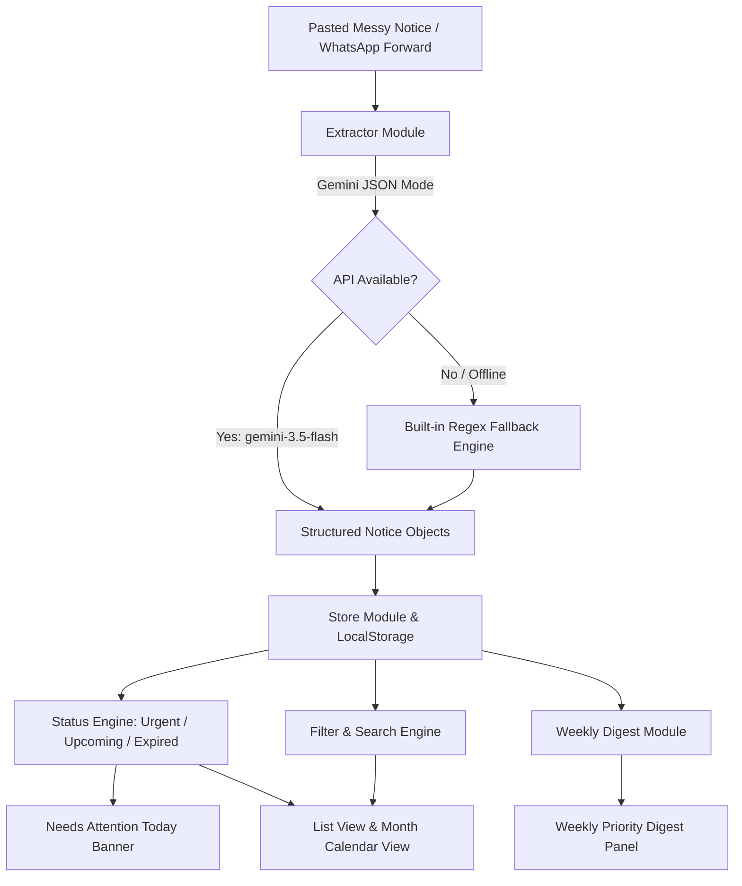

# Campus Pulse 🏛️⚡

[](https://github.com/munazzaghazali7-hash/CampusPulse/actions/workflows/ci.yml)
[](https://github.com/munazzaghazali7-hash/CampusPulse)
[](https://github.com/munazzaghazali7-hash/CampusPulse)
[](https://opensource.org/licenses/MIT)

> **Intelligent campus notice board for students.**  
> Transforms chaotic WhatsApp forwards and department emails into structured, prioritized notices with AI extraction, calendar sync, and weekly digests.

---

## 🏛️ Architecture & Data Flow



---

## ✨ Features

- **🧠 Smart Extraction & Normalization**:
  - Paste messy forwarded text from WhatsApp or email.
  - Gemini API (`gemini-3.5-flash`) extracts clean structured fields: title, date (`YYYY-MM-DD`), time (`HH:MM`), venue, category, and notes.
  - Automatically detects and ignores WhatsApp timestamps (`[24/10/26, 14:32] Prof Sharma:`) so sender names or timestamps are never mistaken for event details.
  - Multi-notice support: handles multiple notices separated by `---` or block breaks.

- **🛡️ Built-in Non-AI Fallback**:
  - Works 100% offline or with zero API key configured.
  - Regex parser intelligently extracts day-first dates, relative dates (*"today"*, *"tomorrow"*, *"yesterday"*, *"5th Nov"*, leap years), times (*"10 AM"*, *"4 PM"*, *"23:59"*, *"12:00 AM"*), and campus venues (*"Hall B"*, *"Seminar Hall"*, *"Main Audi"*).

- **🚨 Priority Engine & Attention Banner**:
  - Live **"Needs attention today"** banner rendered per design specs.
  - Dynamic status labeling:
    - **Urgent**: Today, within 2 days, or a Deadline within 3 days.
    - **Expired**: Past date or event time + 1 hour has elapsed.
    - **Upcoming**: Future notices.
  - Dual accessibility: status is **always** conveyed via explicit text label and color.

- **📅 Organized Views & Filtering**:
  - **List View**: Active urgent items first, upcoming second, expired notices muted last.
  - **Month Calendar View**: Interactive month grid with notice count badges and click-to-filter day inspection.
  - **Search & Chips**: Live search across title, venue, category, and notes; category chips (`Academic`, `Deadline`, `Placement`, `Sports`, `Event`, `Other`).
  - **Google Calendar Sync**: 1-click button to export events with date, time, venue, and notes to Google Calendar.
  - **1-Click Copy**: Copy formatted notice details to clipboard for sharing in study groups.

- **📝 Weekly Digest**:
  - *"What do I need to know this week?"* button generates a sub-100-word digest summarizing immediate priorities.
  - Instant local bullet-point summary fallback if offline.

- **🎨 Editorial Design System**:
  - Built to match the style reference (`DESIGN-3.md`) and strict design rules:
    - Warm Parchment canvas (`#fefffc`), Paper cards (`#ffffff`), Linen inputs (`#f9faf7`).
    - Typography: Fraunces display serif (400 weight) for headings 27px+; Inter sans for all UI.
    - Primary Outlined CTA button in Signal Blue (`#41a1cf`, border/text only, no fill).
    - Secondary Outlined button in Twilight (`#282834`).
    - Frosted Navigation Pill (50px radius) with backdrop blur.

---

## 📋 PRD Requirements Traceability Matrix

| ID | Requirement | Implementation | Automated Test |
|---|---|---|---|
| **R1** | Smart input (messy text $\to$ structured card) | `src/modules/extractor.js` | `tests/extractor.test.js` |
| **R2** | Organised view (search, filter, calendar) | `src/components/FilterBar.jsx`, `CalendarView.jsx` | `tests/filters.test.js` |
| **R3** | Priority & reminders (Urgent/Upcoming/Expired) | `src/modules/status.js`, `AttentionBanner.jsx` | `tests/status.test.js` |
| **R4** | AI summary (under 100 words weekly digest) | `src/modules/digest.js`, `DigestPanel.jsx` | `tests/digest.test.js` |
| **R5** | Usable interface (responsive $\ge 360$px, WCAG a11y) | `src/App.jsx`, `src/App.css`, `index.css` | `tests/edge_cases.test.js` |

---

## 🚀 Getting Started

### Prerequisites
- Node.js (v18+)
- npm

### Installation
```bash
git clone https://github.com/munazzaghazali7-hash/CampusPulse.git
cd CampusPulse
npm install
```

### Environment Configuration
Copy `.env.example` to `.env`:
```bash
cp .env.example .env
```
Add your Gemini API key (optional — app works completely without it via built-in fallback parser):
```env
VITE_GEMINI_API_KEY=your_key_here
```

### Running Locally
```bash
npm run dev
```
Open [http://localhost:5173](http://localhost:5173) in your browser.

---

## 🧪 Testing & CI

Campus Pulse includes 31 automated tests covering unit logic, integration flows, edge cases, date normalization, status rules, deduplication, and XSS sanitization:

```bash
# Run automated tests
npm test

# Run production build
npm run build
```

Every push and pull request is automatically tested and built via GitHub Actions (`.github/workflows/ci.yml`).

---

## 🔒 Security & Privacy

- **Zero Secret Leaks**: API keys are read strictly from environment variables and excluded from git.
- **XSS Protection**: Pasted text is rendered strictly as React children with automatic HTML sanitization.
- **Safe External Links**: All external URLs use `rel="noopener noreferrer"`.
- **LocalStorage Resilience**: All storage accesses are wrapped in `try/catch` with graceful in-memory fallbacks.

---

